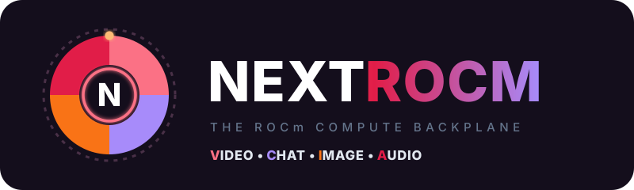

<p align="center"></p>

# nextrocm

Local AI inference for AMD GPUs, written in Rust and HIP. Run text, speech, image and 3D models through one CLI, web interface and HTTP service.

Built on the architecture and interfaces of [nextsycl](https://github.com/maxfridbe/nextsycl) and its nextcuda counterpart. Model loading, scheduling, tokenization and serving live in Rust; GPU operations use native HIP kernels. Python and upstream frameworks are used for independent validation, not production inference.

## What it provides

- A model control panel with enable/disable, GPU selection, pinning, on-demand loading, idle unloading and memory reservations.
- Text chat with streaming and OpenAI-compatible endpoints, plus dedicated audio, image and 3D workflows.
- Packed weights and bounded expert streaming for models whose complete weights do not fit on the GPU.
- Shared Rust contracts with model-specific implementations and private kernels.
- Vendored web build tools: Node.js is needed to build the UI, not to run inference.

## Model support

The development deployment has validated **31 enabled model entries**. This is a tested configuration, not a guarantee that every checkpoint or GPU works.

| Area | Implemented families / checkpoints | Scope |
|---|---|---|
| Text | StableLM Zephyr, Stable Code, Qwen3.5, Qwen3.6, Qwen3-Coder, Inkling-2-Mini | Text chat / completion; checkpoint-specific quantization and configuration |
| Speech recognition | Whisper, Whisper large-v3-turbo, Canary | Native transcription and audio interfaces |
| Speech generation | Qwen3-TTS, VibeVoice, VoxCPM2 int8 | Voice capabilities depend on the selected model |
| Images | Realistic Vision / SD1.5, Qwen Image 2.1 Turbo | Native generation; see accuracy limits below |
| Image processing | Real-ESRGAN, Waifu2x, ISNet, BiRefNet | Upscaling and background removal |
| Vector / 3D | StarVector, RigNet | Experimental vector generation and mesh rigging |

Inkling-2-Mini currently supports **text only, one session, context capacity up to 4096**. Its projector, images, tools and token log-probabilities are not supported. Capacity is not proof of quality across every 4096-token prompt. The selected GGUF is approximately 16.61 GB on disk; host memory and storage requirements are separate from GPU memory. The current source selects a bounded 1 GiB packed-expert cache and a 5 GiB service reservation. Native API callers can explicitly select streaming without that cache; no corresponding CLI flag is claimed.

**Known limits:** Qwen Image 2.1 Turbo produces 1024×1024 images, but its retained full-pipeline comparison fails the original numerical tolerance at late denoising stages and the final image. It was deployed with that limitation explicitly accepted; it is not an accuracy-pass result. StarVector's tested greedy SVG path works, but default sampled output can be unusable and slow. PaddleOCR remains a development port and is not included in the enabled count.

## Build

The measured target is Linux with a Radeon 680M (`gfx1035`). Other GPU architectures have not been established by these results. Install a compatible HIP/ROCm development environment, a C++17 compiler, Rust **1.92 or newer**, and Node.js for the UI. Model weights are downloaded separately and retain their own licenses.

Use the complete runtime recipe; the older root build shortcut does not include every recently added model:

```sh
# Run from the repository root. The runtime output directory must not exist yet.
GPU_ARCH=gfx1035 OUT_DIR="$PWD/runtime-build" bash docs/public-release/build-runtime.sh
bash wfe/build.sh home audio image model3d
NS_LIB_DIST="$PWD/runtime-build" cargo build --release -p nextrocm
./target/release/nextrocm --help
./target/release/nextrocm gpus
./target/release/nextrocm serve 127.0.0.1:8000
```

`NS_LIB_DIST` selects the GPU library **at build time** for embedding in the executable. Rebuild the executable after changing that library. A runtime override can hide an outdated embedded library during testing; validate the default embedded path before distributing a binary. See [build and release preparation](docs/public-release/README.md).

Open the local web interface to configure models and inspect the generated API documentation. Start on loopback; review authentication and network exposure before binding a public interface. No model weights, service credentials, preconfigured private registry or inference binaries are included in this source distribution.

## Validation and performance

Validation separates operator tests, independent reference comparisons, native regression tests, lifecycle checks and HTTP behavior. Passing one does not imply the others. Production inference uses Rust → C ABI → HIP; independent CPU reference tooling is kept outside the runtime.

Before the bounded expert cache was selected, two short Inkling requests on the tested Radeon 680M took approximately **50 seconds each**, with generation around **1.6 tokens/s** and sampled device allocations around **2.76 GB** at context capacity 4096. These are short-request measurements, not a general throughput benchmark. Host RSS and shared GPU allocations must not be added as if they were disjoint on integrated hardware. Optimization remains ongoing.

The selected expert-cache build also passed a separate **private HTTP** check at context capacity 4096: matching streaming/nonstreaming responses took **43.63 / 46.22 seconds**, with sampled device allocations around **3.83 GB**. Unsupported requests were rejected and streamed-disconnect cleanup passed. This is a short-request validation of the default embedded runtime, not a general benchmark. The selected cache integration subsequently passed transactional live deployment, preserving all 31 configured models; the same fixed-prompt checks and idle cleanup passed.

## Repository layout

| Path | Purpose |
|---|---|
| `cli/nextrocm`, `glue/serve` | CLI, HTTP services and model lifecycle |
| `llm`, `audio`, `image`, `model3d`, `vision` | Model implementations and contracts |
| `kernels` | HIP kernels and native interfaces |
| `crates` | Runtime, formats, tokenization, scheduling and shared utilities |
| `model-cards` | Checkpoint metadata |
| `wfe` | Web applications, static assets and vendored build dependencies |

## Licensing and attribution

The workspace declares MIT for its default Rust packages; the CLI and RigNet packages declare **GPL-3.0-only**. The combined CLI must not be presented as MIT-only. Vendored components and derived kernels carry their own notices, and model licenses are independent. See the [licensing inventory and release caveats](docs/public-release/LICENSING.md). No new license grant is implied by this README.

Thanks to the upstream model authors, nextsycl / nextcuda, ROCm, GGML and the Rust ecosystem. Preserve their copyright and license notices when redistributing source or binaries.
